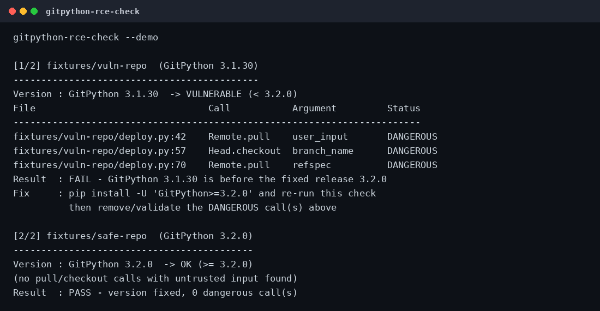

# gitpython-rce-check



**Answer "is my Python project exposed to the GitPython RCE pair?" in 0.106 seconds — one command, zero network calls, zero dependencies.** A stdlib-only Python CLI that checks the two things that decide whether your code is exposed to CVE-2026-110858 and CVE-2026-110859: the installed GitPython version, and whether your code actually passes untrusted input into `Remote.pull()` / `Head.checkout()`. A full demo run takes a median **105.9 ms** (7 runs, measured 2026-11-24 on this machine). No payloads, no network scanning, no exploit code: a defensive checker only.

## Why now

On **2026-11-23**, Red Hat advisory **RHSA-2026:102223** (58 CVEs, 17 critical) disclosed two argument-injection flaws in GitPython, one of the most widely installed Python libraries — so the patch window is measured in hours, not weeks. Both are fixed in **GitPython 3.2.0**.

| CVE | Flaw | CVSS 4.0 | Affected (NVD) | Fixed |
|---|---|---|---|---|
| CVE-2026-110858 | Command injection in `Remote.pull()` — the unsafe-option guard checks only keyword arguments, never the positional refspec, so an attacker-controlled refspec such as `--upload-pack=<command>` runs OS commands as the calling process (local-path or SSH transports) | 9.2 Critical | GitPython 3.1.30 before 3.2.0 | 3.2.0 |
| CVE-2026-110859 | Arbitrary file read in `Head.checkout()` — the positional branch name is not checked for unsafe options, so a repository whose default branch is named like `--pathspec-from-file=<path>` leaks file contents through the error message when a consumer checks out the active branch | 8.7 High | GitPython before 3.2.0 | 3.2.0 |

Version ranges and descriptions verified against the **NVD record for each CVE on 2026-11-24 14:12 CST** (nvd.nist.gov/vuln/detail/CVE-2026-110858 and CVE-2026-110859; both list VulnCheck as CNA and 3.2.0 as unaffected). The CVSS 4.0 scores (9.2 / 8.7) are the CNA scores carried by Red Hat's CVE database and the VulnCheck advisories; NVD itself still shows "Awaiting Enrichment" with no NIST numeric score yet, so the scores are attributed, not NIST's. The tool flags **any GitPython < 3.2.0 as VULNERABLE** — the conservative gate that covers both CVEs (110859 affects all versions before 3.2.0; 110858 is listed by NVD as 3.1.30 before 3.2.0).

Existing version-only checkers stop at "you are on 3.1.x". This one goes one step further: it **AST-scans your code** and shows the exact call sites where untrusted input reaches the dangerous APIs — `deploy.py:42 Remote.pull(user_input)` — so you know whether to patch tonight or next week, and what to fix first.

## Quick start (30 seconds)

```bash
git clone https://github.com/Mahgal/gitpython-rce-check.git
cd gitpython-rce-check
python3 gitpython_rce_check.py --demo   # labelled fixtures: 1 vulnerable, 1 fixed
python3 gitpython_rce_check.py ~/my-project   # check a real project
```

No pip installs, no dependencies — Python 3.8+ only. If GitPython is not installed in the environment, the version line says so plainly (`UNKNOWN`) instead of crying wolf.

Verified from a clean copy (fresh copy in `/tmp`, 2026-11-24): `--demo` runs and the full test suite passes, 24/24, exit 0.

## Example output

Real output of `python3 gitpython_rce_check.py --demo` (captured verbatim to `demo.txt`; re-runs reproduce it byte-for-byte, sha256 `7d8382ae0749396b32b25ceab7ebfe71988b6dadf535d13f4dc821c47804ef83`):

```
gitpython-rce-check --demo

[1/2] fixtures/vuln-repo  (GitPython 3.1.30)
--------------------------------------------
Version : GitPython 3.1.30  -> VULNERABLE (< 3.2.0)
File                               Call           Argument         Status
-------------------------------------------------------------------------
fixtures/vuln-repo/deploy.py:42    Remote.pull    user_input       DANGEROUS
fixtures/vuln-repo/deploy.py:57    Head.checkout  branch_name      DANGEROUS
fixtures/vuln-repo/deploy.py:70    Remote.pull    refspec          DANGEROUS
Result  : FAIL - GitPython 3.1.30 is before the fixed release 3.2.0
Fix     : pip install -U 'GitPython>=3.2.0' and re-run this check
          then remove/validate the DANGEROUS call(s) above

[2/2] fixtures/safe-repo  (GitPython 3.2.0)
-------------------------------------------
Version : GitPython 3.2.0  -> OK (>= 3.2.0)
(no pull/checkout calls with untrusted input found)
Result  : PASS - version fixed, 0 dangerous call(s)
```

Reading it: the vulnerable fixture runs GitPython 3.1.30 and has three dangerous calls — a `user_input` function parameter passed to `Remote.pull()`, a caller-supplied `branch_name` passed to `Head.checkout()`, and a `sys.argv[1]` value passed to `Remote.pull()`. The fixed fixture runs 3.2.0 and passes only constant strings (`"main"`), so it is clean.

## How it works

1. **Version gate.** Reads the installed GitPython version via `importlib.metadata` and compares it against the fixed release 3.2.0. `< 3.2.0` → VULNERABLE; `>= 3.2.0` → OK; not installed → UNKNOWN (scanning still runs).
2. **Call-site scan.** Recursively walks the target directory's `.py` files, parses each with `ast`, and finds `Remote.pull()` / `Head.checkout()` calls (including `repo.remotes.*.pull()`). For each call's first argument it applies a taint heuristic:
   - **DANGEROUS** — the argument comes from untrusted input: a function parameter whose name suggests outside data (`user_input`, `branch_name`, `refspec`, …), a value assigned from `sys.argv` / `os.environ` / `request.*`, or an `input()` / `os.getenv()` call.
   - **REVIEW** — a non-constant argument the heuristic cannot prove tainted (e.g. a parameter named `tag`). Listed for a human to judge; does not fail the run on its own.
   - **Not reported** — constant strings (`pull("main")`) and locals assigned a constant string. No false alarms on pinned refspecs.
3. **Verdict.** `FAIL` if the version is vulnerable or any DANGEROUS call is found, with the fix (`pip install -U 'GitPython>=3.2.0'`) printed next to the offending lines. Files with syntax errors are skipped (listed in the output) instead of crashing the scan.

## Exit codes

| Code | Meaning |
|---|---|
| 0 | Safe: version fixed (or not installed) and 0 dangerous calls |
| 1 | Hit: vulnerable version and/or dangerous call(s) found — this is the designed behaviour, not an error |
| 2 | Usage error (e.g. path is not a directory) |

## Options

```
python3 gitpython_rce_check.py [PATH] [--demo] [--gitpython-version VER]
```

- `PATH` — directory of `.py` files to scan (default: current directory).
- `--demo` — run the labelled fixtures (vulnerable, then fixed). Deterministic: no clock, no absolute paths, no randomness.
- `--gitpython-version VER` — override the detected GitPython version (for fixtures, tests and CI).

## Tests

```bash
python3 tests/run_tests.py   # 24 tests, stdlib unittest only
```

Coverage: version boundaries (3.1.30 / 3.1.62 / 3.2.0 / 3.2.1 / not installed), AST hits (tainted parameter, `sys.argv`, `os.environ`, `checkout`), false-positive guards (constant strings and constant-assigned locals are never reported), multi-file scans, empty directories, syntax-error files skipped without crashing, exit codes (0 / 1 / 2), and demo byte-determinism.

## Limitations (honest)

- The taint check is a **heuristic**, not a proof: it flags values that *look* untrusted by name or source. A clean result means "no dangerous call found by this scan", not "provably safe" — review REVIEW rows by hand.
- The version gate is conservative by design: any version < 3.2.0 is flagged, because CVE-2026-110859 affects all of them, even though NVD lists CVE-2026-110858's range more narrowly (3.1.30 before 3.2.0).
- Sources & caveats: NVD records are "Awaiting Enrichment" (no NIST score yet); CVSS numbers are the CNA's. One secondary summary notes the GitHub advisory body questions whether 3.2.0 fully fixes CVE-2026-110858 — the tool follows NVD (3.2.0 unaffected); re-check the advisory before treating 3.2.0 as the final word.
- Fixture code is labelled simulation-only: it models the *shape* of dangerous calls for the scanner to find. It contains no exploit and is never executed by the demo.

## License

MIT — see [LICENSE](LICENSE).
